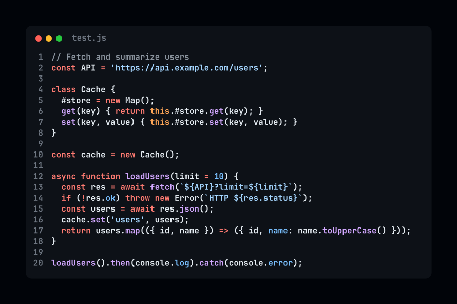
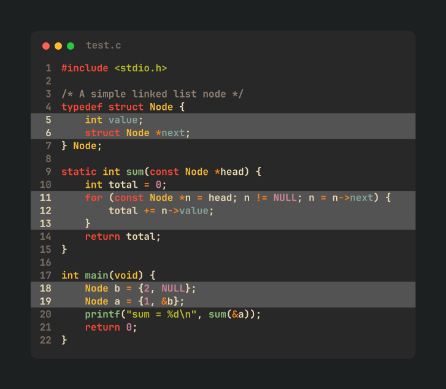
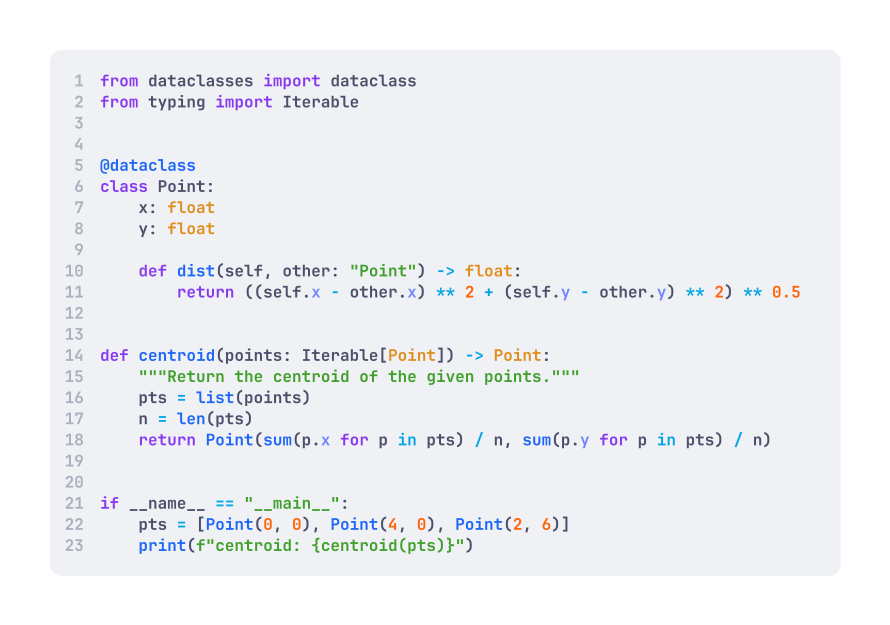

<p align="center">
  
</p>

# Znip

**Turn source code into images, straight from your terminal.**



Znip reads a file, stdin or your clipboard, syntax-highlights it with [Tree-sitter](https://tree-sitter.github.io/), and renders a polished PNG with [Blend2D](https://blend2d.com/). No browser, no GUI, one binary.

## Features

- PNG output with a window frame, line numbers, file name and optional drop shadow
- 16 languages built in, plus any other Tree-sitter grammar downloaded on demand
- 21 built-in themes, custom themes and custom fonts
- Line ranges (`-s` / `-e`) and line highlighting (`--highlight`)
- Transparent canvas for dropping the image onto any background
- Clipboard in and out (macOS and Linux)
- Interactive step-by-step wizard (`-i`) and reusable presets
- Reads from a file, a pipe, or the clipboard

## Installation

> **Currently supported on macOS only** (Apple Silicon and Intel). Linux users can [build from source](#build-from-source).

### 1. Download

Download the archive for your Mac from the [latest release](https://github.com/MetoA/znip/releases/latest):

| Mac | Asset |
|---|---|
| Apple Silicon (M1 and later) | `znip-macos-aarch64.tar.gz` |
| Intel | `znip-macos-x86_64.tar.gz` |

Not sure which one you have? Run `uname -m`: `arm64` means Apple Silicon, `x86_64` means Intel.

### 2. Install

The commands below put Znip in `$HOME/.znip/bin`. It lives next to Znip's config directory (`~/.znip`) and needs no `sudo`. Run them from the folder you downloaded the archive to (swap in the Intel asset name if needed):

```sh
# Create the install folder and unpack the binary
mkdir -p "$HOME/.znip/bin"
tar -xzf znip-macos-aarch64.tar.gz -C "$HOME/.znip/bin"
chmod +x "$HOME/.znip/bin/znip"

# macOS blocks unsigned binaries downloaded from the internet, so clear the quarantine flag
xattr -d com.apple.quarantine "$HOME/.znip/bin/znip" 2>/dev/null || true

# Make `znip` available everywhere
echo 'export PATH="$HOME/.znip/bin:$PATH"' >> "$HOME/.zshrc"
source "$HOME/.zshrc"
```

Using bash instead of zsh? Append the `export` line to `~/.bash_profile` instead.

### 3. Verify

```sh
which znip     # -> /Users/<you>/.znip/bin/znip
znip --help
```

From now on you can run `znip` from any directory:

```sh
znip path/to/file.py
```

### Uninstall

```sh
rm -f "$HOME/.znip/bin/znip"
```

Then remove the `export PATH="$HOME/.znip/bin:$PATH"` line from `~/.zshrc`. To also remove your config, themes, fonts and cached grammars, delete `~/.znip`.

### Build from source

<details>
<summary>Requirements and steps</summary>

You need [Zig](https://ziglang.org/download/) 0.15.2 or newer. Blend2D and Tree-sitter are vendored, and the Zig dependencies are fetched during the build.

```sh
git clone --recurse-submodules https://github.com/MetoA/znip.git
cd znip
zig build -Doptimize=ReleaseFast
./zig-out/bin/znip --help
```

The binary is `zig-out/bin/znip`. Copy it into `$HOME/.znip/bin` and follow the PATH step above to use it globally.

Useful build options:

| Option | Effect |
|---|---|
| `-Doptimize=ReleaseFast` | Optimized build (`ReleaseSafe` and `ReleaseSmall` also work) |
| `-Dwasm=false` | Skip on-demand WASM grammars. Smaller binary, no wasmtime, and only the built-in languages |
| `zig build test` | Run the test suite |

On Linux the clipboard features need `wl-clipboard` (Wayland) or `xclip` (X11).

</details>

## Quick start

```sh
# Render a whole file
znip main.zig

# Render lines 10-30 of a file
znip -s 10 -e 30 server.py

# Highlight lines 5, and 8 to 10
znip --highlight 5,8-10 app.ts

# Pick the output name and open the result when done
znip -o -n demo main.go

# Pipe code in (set the language yourself, there is no file extension to go by)
cat snippet.rs | znip --lang rust

# Clipboard in, clipboard out
znip --from-clipboard --lang python --to-clipboard

# Walk through the options step by step
znip -i main.zig
```

By default, the image is saved in the current directory as `znip_output_<unix-timestamp>.png`. Use `-n` to choose the name and `--output-dir` to choose where images are saved.



## How it works

```
 file / stdin / clipboard
          │
          ▼
  detect the language ──►  --lang, file extension, ```fence tag, shebang,
          │                cached WASM grammar, then content sniffing
          ▼
  Tree-sitter parse   ──►  syntax tree -> highlighted tokens
          │
          ▼
  theme + preset      ──►  colors, font, size, padding, window style
          │
          ▼
  Blend2D renders     ──►  window frame, line numbers, code, shadow
          │
          ▼
       PNG file  ──►  optional: open in viewer, copy to clipboard
```

1. **Input.** Znip reads one source: a file path, piped stdin, or `--from-clipboard`. Input is limited to 10 MB, and empty or binary input is rejected. `-s` and `-e` only apply to files.
2. **Language detection.** In order: `--lang`, the file extension, a leading code fence tag (a first line like ` ```python `), a shebang (`python`, `ruby`, `node`, `deno`, `bun`), then a cached or downloadable WASM grammar that matches. As a last resort, Znip parses the first 16 KB with every built-in grammar and keeps the best result.
3. **Parsing.** Tree-sitter builds a syntax tree, and the theme's syntax colors are applied to each token.
4. **Rendering.** Blend2D draws the window (traffic-light controls, file name, line numbers, drop shadow) using the active preset: theme, font, font size and padding. Images can be at most 65535 px per side.
5. **Output.** The image is written as a PNG. If a file with that name already exists, Znip adds a unique suffix instead of overwriting it.

## Command reference

```
znip [OPTIONS] [FILE]
```

| Short | Long | Value | Description |
|---|---|---|---|
| `-h` | `--help` | | Show help and exit |
| `-s` | `--start` | `<line>` | First line to render (1-based) |
| `-e` | `--end` | `<line>` | Last line to render (must be after `--start`) |
| | `--highlight` | `<spec>` | Highlight lines, e.g. `5,8-10` (1-based, must fall inside the rendered range) |
| | `--from-clipboard` | | Use the text in your clipboard as input |
| | `--to-clipboard` | | Copy the generated image to your clipboard |
| | `--transparent` | | Transparent outer canvas (the code window stays opaque) |
| `-o` | `--open` | | Open the image in your default viewer when done |
| `-i` | `--interactive` | | Step-by-step wizard for choosing options |
| `-p` | `--preset` | `<name>` | Use a specific preset for this run |
| | `--font` | `<name>` | Override the font for this run (font file name without extension) |
| | `--font-size` | `<px>` | Override the font size, 1 to 512 |
| `-n` | `--name` | `<name>` | Output file name (`.png` is appended if missing, subfolders are created) |
| | `--lang` | `<language>` | Skip detection and use this language (names and aliases like `rs`, `py`, `ts`, `c++` work) |
| | `--install-lang` | `<language>` | Download and cache a WASM grammar, then exit |
| | `--output-dir` | `<dir>` | Set the default folder where images are saved, then exit |
| `-y` | `--yes` | | Don't ask before downloading an on-demand grammar |

Only one input source can be used at a time: a file, `--from-clipboard`, or piped stdin.

### Themes

```sh
znip theme list                          # all themes, the active one is marked
znip theme show Dracula                  # show one theme's colors
znip theme use "Tokyo Night"             # set the active preset's theme
znip theme create mytheme --from Nord    # scaffold a custom theme (add --force to overwrite)
```

Theme names are case-sensitive, so quote the ones with spaces.

## Languages

Built in, with no downloads needed:

| Language | Extensions |
|---|---|
| C | `.c` |
| C++ | `.cpp` `.cc` `.cxx` `.hpp` `.hh` `.hxx` |
| CSS | `.css` |
| Go | `.go` |
| HTML | `.html` `.htm` |
| Java | `.java` |
| JavaScript | `.js` `.mjs` `.cjs` `.jsx` |
| JSON | `.json` |
| Markdown | `.md` `.markdown` |
| PHP | `.php` |
| Python | `.py` `.pyi` |
| Ruby | `.rb` |
| Rust | `.rs` |
| SQL | `.sql` |
| TypeScript | `.ts` `.tsx` `.mts` `.cts` |
| Zig | `.zig` |

### Other languages

For anything else, Znip can fetch a Tree-sitter grammar the first time you need it. It asks before downloading, or pass `-y` to skip the prompt:

```sh
znip --install-lang ruby     # download ahead of time
znip -y program.cob          # download if needed, no prompt
```

Grammars are cached in `~/.znip/grammars/` and are downloaded from the [znip_grammars](https://github.com/MetoA/znip_grammars) releases. A build made with `-Dwasm=false` supports only the built-in languages above.

## Themes and fonts

**Built-in themes:** One Darker (default), Midnight Aurora, Solarized Light, Paper White, Dracula, Nord, Gruvbox Dark, Tokyo Night, Catppuccin Mocha, Monokai, GitHub Dark, Rose Pine, Solarized Dark, Night Owl, GitHub Light, One Light, Gruvbox Light, Catppuccin Latte, Tokyo Night Day, Rose Pine Dawn, Ayu Light.

**Custom themes** are JSON files in `~/.znip/themes/<name>.json`. A custom theme with the same name as a built-in one takes priority. Colors are `#rrggbb` or `#rrggbbaa`, split into `ui` and `syntax` groups. `znip theme create` generates a starting point.

**Fonts.** JetBrains Mono Bold is bundled and is the default. Znip also finds fonts (`.ttf`, `.otf`, `.ttc`, `.otc`) in:

- `~/.znip/fonts`
- any folders listed under `font_directories` in `~/.znip/config.json`
- the system font folders (`/System/Library/Fonts`, `/Library/Fonts` and `~/Library/Fonts` on macOS)

Select one with the file name without its extension:

```sh
znip --font Inter-Bold --font-size 20 main.zig
```



## Configuration

Znip creates `~/.znip/` on first run:

```
~/.znip/
├── config.json     # active preset, output directory, extra font directories
├── presets/        # saved presets (default.json is created for you)
├── themes/         # your custom themes
├── fonts/          # drop extra fonts here
├── grammars/       # cached on-demand grammars
└── bin/            # where the binary lives if you followed the install steps
```

A preset bundles the look of your images. The defaults:

| Setting | Default |
|---|---|
| `theme` | One Darker |
| `font` | JetBrainsMono-Bold |
| `font_size` | 16 |
| `window_controls` | `true` |
| `show_file_name` | `true` |
| `vertical_padding_px` | 50 |
| `horizontal_padding_px` | 50 |
| `include_drop_shadow` | `true` |
| `transparent_background` | `false` |

Edit `presets/default.json` by hand, or run `znip -i` and save the result as a new preset. Switch between presets with `-p <name>`.

## Clipboard

| | Read (`--from-clipboard`) | Write (`--to-clipboard`) |
|---|---|---|
| macOS | `pbpaste` | `osascript`, nothing extra to install |
| Linux (Wayland) | `wl-paste` | `wl-copy` |
| Linux (X11) | `xclip` or `xsel` | `xclip` (`xsel` can't copy images) |

`-o` opens the image with `open` on macOS and `xdg-open` on Linux.

## Credits

Znip is built with [Zig](https://ziglang.org/), [Blend2D](https://blend2d.com/), [Tree-sitter](https://tree-sitter.github.io/), [zig-clap](https://github.com/Hejsil/zig-clap), [libvaxis](https://github.com/rockorager/libvaxis) and [wasmtime](https://wasmtime.dev/). The bundled font is [JetBrains Mono](https://www.jetbrains.com/lp/mono/).

## License

<!-- TODO: choose a license and add a LICENSE file -->
To be decided.
